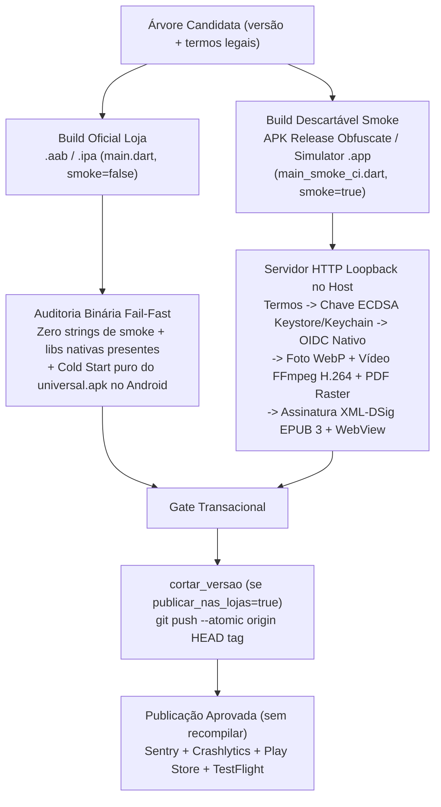

# Design

## Context

Veja `proposal.md` para a motivação completa. Dois requisitos arquiteturais centrais moldam esta solução no Fixalog:
1. **Valor probatório e segurança dos artefatos de produção**: Os pacotes `.aab` e `.ipa` enviados para a Google Play e App Store não podem conter portas traseiras, receptores de `Intent` de teste nem desvios de autenticação OIDC que um aplicativo malicioso vizinho em um celular físico possa acionar via `127.0.0.1`.
2. **Invariantes do `AGENTS.md`**: Todo código em `app/lib/` exige espelhamento 1:1 em `app/test/`, 100% de cobertura comportamental sem código morto (proibindo ramos `const bool.fromEnvironment(..., defaultValue: false)` inalcançáveis nos testes unitários) e ausência de mocks internos (`mocktail`/`Mock`).

## Goals / Non-Goals

**Goals:**
- Garantir fisicamente zero bytes de código de smoke test nos binários oficiais `.aab` e `.ipa` distribuídos às lojas, comprovado por auditoria binária automatizada no CI.
- Exercitar em emulador Android KVM (`x86_64`) e iOS Simulator (`arm64`) toda a pilha nativa crítica pós-build (`sqflite`, `FlutterSecureStorage` Keystore/Keychain, `MethodChannel` OIDC nativo, `flutter_image_compress` WebP, `ffmpeg_kit_flutter_new` H.264, `printing` PDFium raster, assinatura XML-DSig ECDSA e `webview_flutter`).
- Reordenar os workflows de release para que o corte atômico de versão (`git push --atomic`) e a publicação nas lojas só ocorram após aprovação simultânea de Android e iOS, oferecendo modo `publicar_nas_lojas: false` para validação interna segura.

**Non-Goals:**
- Executar o `.ipa` assinado para `iphoneos` em fazendas pagas de dispositivos físicos iOS (o Simulator Apple Silicon cobre CocoaPods, Swift, Keychain, SQLite, FFmpeg, PDFium e WebView, complementado por inspeção estática Mach-O/`codesign` do `.ipa`).
- Alterar o fluxo de autenticação OIDC de produção do usuário final (`lib/main.dart`).

## Decisions

### 1. Segregação por Entrypoint Dedicado (`--target`) + Compilação Condicional Nativa
- **Escolha**: Manter `app/lib/main.dart` 100% livre de referências a smoke test e criar `app/lib/core/smoke_ci/main_smoke_ci.dart` + `executor_jornada_smoke.dart` (totalmente testáveis em `app/test/core/smoke_ci/` com 100% de cobertura).
  - Nos builds oficiais de loja (`flutter build appbundle` e `flutter build ipa`), o entrypoint padrão `lib/main.dart` não importa `smoke_ci/`, fazendo o compilador AOT excluir integralmente esses módulos do `libapp.so` e `App.framework`.
  - Na camada nativa Android (`build.gradle.kts` + `MainActivity.kt`), `BuildConfig.ARESTA_SMOKE_CI` é `false` por padrão (eliminado pelo R8 no `.aab` oficial) e só recebe `true` quando compilado com `ORG_GRADLE_PROJECT_arestaSmokeCi=true` para o APK descartável de smoke, exigindo adicionalmente detecção de hardware virtual QEMU (`ranchu`/`goldfish`/`sdk_gphone`) e host loopback (`10.0.2.2`, `127.0.0.1`, `localhost`).
  - Na camada nativa iOS (`AppDelegate.swift`), o canal `com.arestaclimb.fixalog/smoke_ci` e o desvio de `solicitarIdTokenGoogle`/`solicitarIdTokenApple` para `POST <smokeServer>/__smoke__/oidc-token` ficam dentro de `#if targetEnvironment(simulator)`, que o compilador Swift jamais inclui em compilações `iphoneos` (`.ipa`).
- **Alternativa descartada**: Embutir flag de runtime por `Intent` no próprio `.aab` da loja — rejeitada porque `MainActivity` é `exported="true"` e qualquer app instalado no mesmo celular físico pode abrir portas em `127.0.0.1` e enviar `Intent`s com extras arbitrários.

### 2. Fluxo Duplo no CI: Cold Start do Pacote Oficial + Jornada Completa no Pacote Gêmeo

- **Racional**: O `.aab` oficial exato é auditado binariamente e testado em Cold Start puro via `bundletool build-apks --mode=universal`, enquanto o APK gêmeo (`--release --obfuscate` com o mesmo R8 e `proguard-rules.pro`) e o `Runner.app` do Simulator validam toda a jornada autenticada e pericial, reportando `POST /__smoke__/relatorio` via HTTP loopback (evitando depender de `adb shell run-as`, bloqueado em builds `--release` não-depuráveis).

### 3. Topologia Transacional Modular Reutilizando `build_android.yml` e `build_ios.yml`
- **Escolha**: Parametrizar `build_android.yml` e `build_ios.yml` com `etapa: 'build_e_smoke' | 'publicar'` e passar o estado candidato preparado no Job 1 via artifact `pacote-candidato-release` (contendo `pubspec.yaml` e `versao_legal.g.dart` atualizados + `git submodule` sincronizado).
  - Na etapa `build_e_smoke`, cada SO compila, audita, executa o smoke test e publica os artefatos de staging (`android-release-<tag>` e `ios-release-<tag>`).
  - Na etapa `cortar_versao` (em `release_new_app_version.yml`), os commits e a tag só são criados e enviados via `git push --atomic` se todos os jobs habilitados de `build_e_smoke` vencerem e `publicar_nas_lojas == true`.
  - Na etapa `publicar`, cada SO baixa seu artifact de staging já assinado e executa apenas o upload de símbolos (Sentry + Crashlytics) e publicação nas lojas (preservando o fallback Python da Google Play e as 3 tentativas do `xcrun altool`).

## Risks / Trade-offs

- **[Tempo adicional de emulador no CI (~4–6 min)]** → Mitigação: Usar imagem Android API 34 `default;x86_64` com aceleração KVM nativa em `ubuntu-latest`, vídeo sintético curto de 1s gerado via `FFmpegKit` (`lavfi`/`color`) e compilação incremental `android-x64` para o APK de smoke aproveitando o cache Gradle recém-aquecido pelo `.aab`.
- **[Keychain `-34018 errSecMissingEntitlement` no iOS Simulator]** → Mitigação: Compilar `flutter build ios --simulator` mantendo a assinatura ad-hoc local padrão do Simulator (sem `--no-codesign`), garantindo que o `SecItemAdd` do `FlutterSecureStorage` funcione fielmente no Simulator.

## Migration Plan

1. Implementar módulos `smoke_ci`, Fakes determinísticos para `generation_flow_test.dart`, ferramentas CLI (`auditar_binario_loja.dart`, `servidor_smoke_ci.dart`, `smoke_test_pacote.dart`) e guardas nativas Kotlin/Swift com 100% de testes locais.
2. Atualizar `release_new_app_version.yml`, `build_android.yml`, `build_ios.yml` e `pipeline_ci_android_test.dart`.
3. Disparar `release_new_app_version.yml` com `publicar_nas_lojas: false` e validar evidência verde em Android e iOS antes de qualquer release pública.
