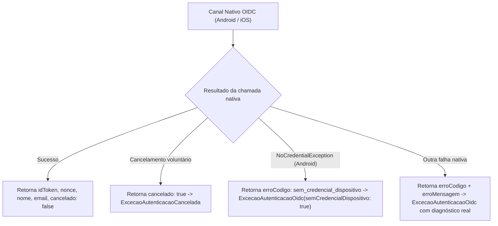
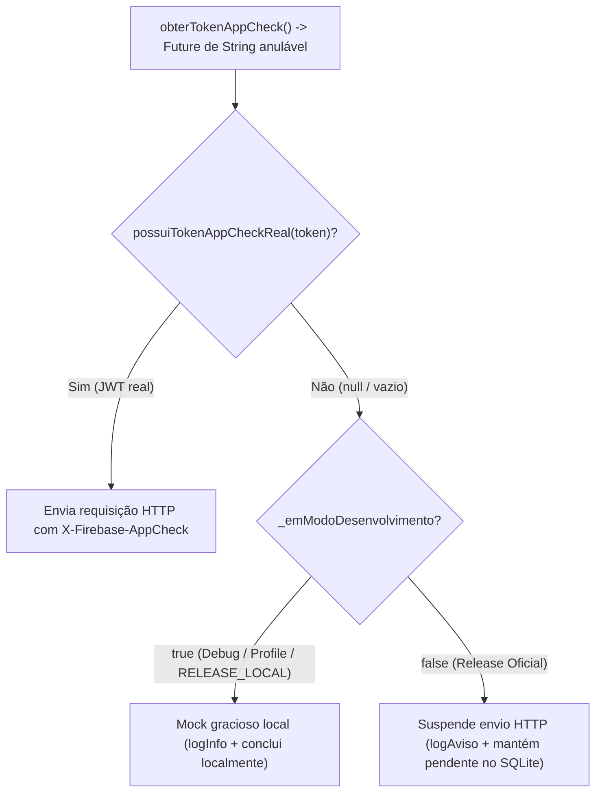

# Design

## Context

Consulte `proposal.md` para a motivação completa das Issues #9 (`FIXALOG-5`) e #10 (`FIXALOG-6` / `FIXALOG-7`) e os deltas em `specs/` para os contratos observáveis. As alterações cruzam os canais nativos (`MainActivity.kt` e `AppDelegate.swift`), `AutenticacaoNuvemService`, `IdentityFormViewModel`, `ServicoFilaFeedback`, `SincronizadorNuvemService`, `AgendadorSincronizacaoBackground` e `RegistroLogger`, devendo manter espelhamento 1:1 de testes e 100% de cobertura comportamental conforme `AGENTS.md`.

## Goals / Non-Goals

**Goals:**
- Preservar os códigos e mensagens reais de erro dos seletores nativos OIDC (Android e iOS), extinguindo o retorno opaco `null` em falhas conhecidas.
- Tratar ausência de conta Google no Android (`NoCredentialException`) como condição ambiental do aparelho (`logAviso` + mensagem localizada na UI), sem gerar issues no Sentry.
- Eliminar completamente `tokenAppCheckFallbackLocal` de `app/lib/`, impedindo o envio de cabeçalhos `X-Firebase-AppCheck` sintéticos em produção.
- Rebaixar falhas definitivas de sincronização tratadas em `logFalhaSyncOuDownload` de `fatal: true` para `fatal: false`, preservando `fatal: true` apenas para crashes não tratados.
- Evitar consumo contínuo de bateria no `AgendadorSincronizacaoBackground` pausando o timer automático ao esgotar os passos de *backoff* até a próxima retomada/ação.

**Non-Goals:**
- Alterar a lógica de validação criptográfica de App Check na Edge Function `app-feedback` ou no Cloudflare Worker `fixalog.app`.
- Introduzir login OAuth via navegador externo no Android.

## Decisions

### 1. Protocolo Estruturado do Canal Nativo OIDC (`MainActivity.kt`, `AppDelegate.swift` e `AutenticacaoNuvemService`)

- **Decisão**:
  - **Android (`MainActivity.kt`)**: Capturar `NoCredentialException` (`androidx.credentials.exceptions.NoCredentialException`) antes do `catch (e: Exception)` geral, retornando `mapOf("erroCodigo" to "sem_credencial_dispositivo", "erroMensagem" to (e.message ?: "No credentials available"))`. No `catch (e: GetCredentialException)` / `catch (e: Exception)` geral, retornar `mapOf("erroCodigo" to e.javaClass.simpleName, "erroMensagem" to (e.message ?: e.javaClass.simpleName))` em vez de `null`.
  - **iOS (`AppDelegate.swift`)**:
    - Em `iniciarLoginNativoGoogle`: se `let erroWeb = error as? ASWebAuthenticationSessionError, erroWeb.code == .canceledLogin`, retornar `["cancelado": true]`. Caso haja outro `NSError`, retornar `["erroCodigo": "\(nsError.domain):\(nsError.code)", "erroMensagem": nsError.localizedDescription]`.
    - Em `authorizationController(didCompleteWithError:)`: manter `.canceled` -> `["cancelado": true]` e, para demais erros, retornar `["erroCodigo": "\(nsError.domain):\(nsError.code)", "erroMensagem": nsError.localizedDescription]`.
  - **Dart (`AutenticacaoNuvemService` e `IdentityFormViewModel`)**:
    - Adicionar em `ExcecaoAutenticacaoOidc` a propriedade booleana `final bool semCredencialDispositivo` (padrão `false`) e `final String? codigoErroNativo`.
    - Em `_autenticadorOidcPadrao`: após checar `cancelado == true`, verificar se `respostaNativa['erroCodigo']` está preenchido; se `erroCodigo == 'sem_credencial_dispositivo'` (ou `erroMensagem` contiver `'no credentials available'` case-insensitive), lançar `ExcecaoAutenticacaoOidc(..., semCredencialDispositivo: true, codigoErroNativo: erroCodigo)`. Caso seja outro `erroCodigo`, lançar `ExcecaoAutenticacaoOidc('Falha no canal nativo OIDC (${provedor.valor}) [$erroCodigo]: $erroMensagem', codigoErroNativo: erroCodigo)`.
    - Em `IdentityFormViewModel.autenticarComProvedor`: se `e is ExcecaoAutenticacaoOidc && e.semCredencialDispositivo`, registrar apenas `_logger.logAviso(...)` e definir `errorMessage: l10n.identidadeErroSemContaDispositivoOidc` (adicionada nos 7 `.arb`), sem chamar `_logger.logError`.
- **Alternativas consideradas**:
  - *Criar uma terceira classe de exceção separada*: Adicionar `semCredencialDispositivo` e `codigoErroNativo` diretamente em `ExcecaoAutenticacaoOidc` mantém a hierarquia enxuta (Princípio VI do `AGENTS.md`) e preserva compatibilidade com `AutenticacaoNuvemServiceFake`.

### 2. Remoção de `tokenAppCheckFallbackLocal` e Guarda Obrigatória de App Check em Produção

- **Decisão**:
  - Remover `tokenAppCheckFallbackLocal` de `AutenticacaoNuvemService`.
  - Alterar `AutenticacaoNuvemService.obterTokenAppCheck()` e o callback `provedorTokenAppCheck` para `Future<String?>`, retornando diretamente `ServicoAppCheck.instancia.obterToken()` (`null` quando indisponível). Simplificar `possuiTokenAppCheckReal(String? token)` para `token != null && token.trim().isNotEmpty`.
  - Em `ServicoFilaFeedback.enviarItemFeedback`:
    - Se `!AutenticacaoNuvemService.possuiTokenAppCheckReal(tokenAppCheck)`:
      - Quando `_emModoDesenvolvimento == true`: executa o `[DEBUG MOCK]` existente e retorna `true`.
      - Quando `_emModoDesenvolvimento == false`: registra `_logger.logAviso('🛡️ [ServicoFilaFeedback] Envio de feedback (${item.idFeedback}) adiado: token do App Check indisponível.')` e retorna `false` imediatamente, sem instanciar requisição HTTP.
  - Em `SincronizadorNuvemService` (`_executarEnvioSubmissao`, `publicarEAguardarLiberacao` e `restaurarRelatoriosDaConta`):
    - Aplicar a mesma bifurcação simétrica: quando `!possuiTokenAppCheckReal(tokenAppCheck)` e `!_emModoDesenvolvimento`, registrar `_logger.logAviso(...)` e abortar a chamada HTTP sem lançar erro no Sentry (em `publicarEAguardarLiberacao`, emitir `EtapaPublicacaoLaudo.semInternet` com mensagem amigável indicando indisponibilidade temporária de verificação de segurança/rede).
- **Alternativas consideradas**:
  - *Tentar enviar requisição sem o cabeçalho `X-Firebase-AppCheck`*: Descartado porque tanto a Edge Function `app-feedback` quanto o Cloudflare Worker `fixalog.app` exigem obrigatoriamente `X-Firebase-AppCheck` e rejeitariam com `HTTP 401/403`.

### 3. Severidade Não-Fatal em `RegistroLogger.logFalhaSyncOuDownload`

- **Decisão**:
  - Em `RegistroLogger.logFalhaSyncOuDownload`, substituir a chamada `logCrash(...)` por `logError(..., fatal: false)`.
  - `logCrash` permanece disponível e utilizado pelos handlers globais de exceções não tratadas em `main.dart` (`FlutterError.onError` e `PlatformDispatcher.instance.onError`) e pelo relatório final consolidado do `MotorRoboCaotico`.
- **Alternativas consideradas**:
  - *Manter `logCrash` apenas para erros de assinatura criptográfica*: Mesmo um erro de validação HTTP `400` em uma submissão isolada não derruba o processo do aplicativo; `SentryLevel.error` já abre issue imediata no Sentry sem falsificar a métrica de *Crash-Free Sessions* nem acionar alertas de emergência de crash fatal.

### 4. Teto de Retentativas Consecutivas no `AgendadorSincronizacaoBackground`

- **Decisão**:
  - Hoje `_agendarProximaTentativaComBackoff()` faz `if (_indiceBackoff < _intervalosBackoff.length - 1) _indiceBackoff++;` e continua agendando timers de `120s` para sempre.
  - Alterar para consumir cada degrau de `_intervalosBackoff` exatamente uma vez (`_indiceBackoff < _intervalosBackoff.length`): enquanto houver degraus restantes, agenda `Timer(_intervalosBackoff[_indiceBackoff++], ...)`; quando `_indiceBackoff >= _intervalosBackoff.length`, `cancelarTimer()` é chamado sem reagendar novo timer automático.
  - Em `iniciarMonitoramento()` e `aoRetomarAplicativo()`, redefinir `_indiceBackoff = 0` antes de chamar `executarCicloSeNecessario()`, garantindo que uma nova selagem de laudo ou o retorno do usuário ao aplicativo conceda uma nova janela limpa de *backoff* (`30s -> 60s -> 120s`).

## Risks / Trade-offs

- **[Mudança de assinatura `Future<String?> obterTokenAppCheck()` nos testes existentes]** → **Mitigação**: Atualizar `AutenticacaoNuvemServiceFake` (permitindo configurar `tokenAppCheck` como `String?`, padrão `'app_check_token_valido'`) e os testes unitários/integração correspondentes.
- **[Dispositivo físico temporariamente em cooldown de 5 min do App Check ao retomar o app]** → **Mitigação**: Ao pausar após `30s + 60s + 120s`, a bateria é poupada durante o cooldown e a próxima retomada do app (`aoRetomarAplicativo`) reinicia o contador de *backoff* quando o cooldown já tiver expirado.
